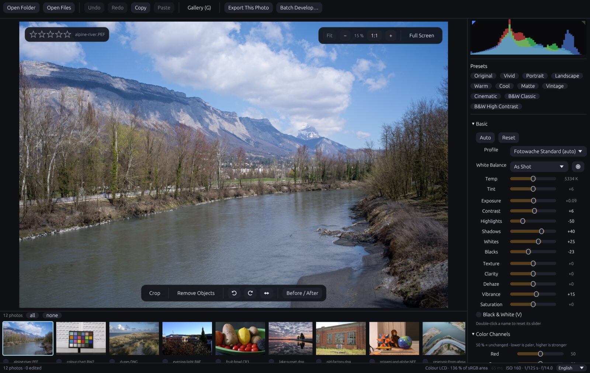
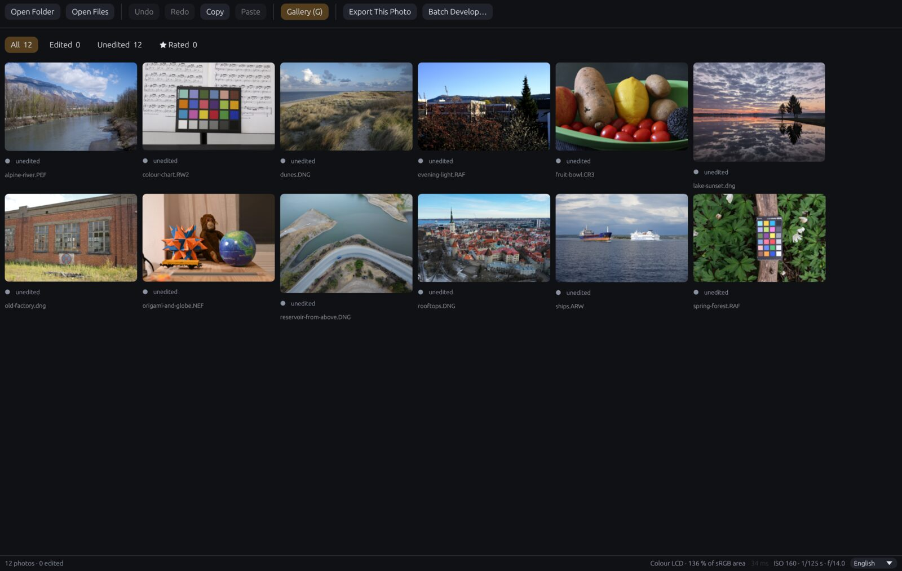
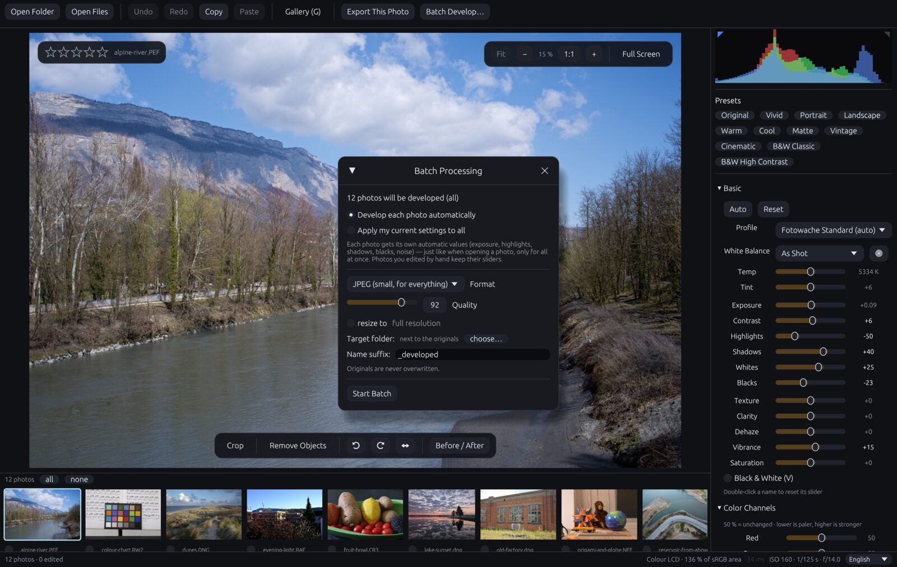

# Fotowache

[](LICENSE)
[](https://github.com/robeertm/Fotowache/releases/latest)
[](https://github.com/robeertm/Fotowache/actions/workflows/build.yml)
[](#everything-else)

**A native RAW photo developer for the desktop.** Open a folder of RAW files
from almost any camera, get a balanced starting point for every photo,
fine-tune it with familiar sliders, and export full-resolution JPEG, PNG or
16-bit TIFF — one photo or a whole folder at once.

Everything runs on your computer. The processing pipeline runs on the graphics
card in 32-bit floating point, so dragging a slider updates a 40-megapixel
photo in milliseconds.



> ⚠️ **Please read before installing.**
> Fotowache was designed and written almost entirely by an AI assistant, working
> from the author's requirements and checked by a human against real photos
> before each release. It is a hobby project, not a commercial product.
>
> - **Your RAW files are never modified.** Fotowache stores its settings in a
>   small `<photo>.fotowache.json` file next to each RAW and writes exported
>   images to the folder you choose. Exporting again with the same settings
>   replaces the earlier export of the same name.
> - **Keep backups of your originals anyway** — that is good practice with any
>   photo software, and this one has no warranty (see [LICENSE](LICENSE)).
> - **Colours are an interpretation.** Fotowache follows the public DNG colour
>   model and was tuned against finished reference edits, but it does not
>   guarantee any particular look. For colour-critical work (print, product
>   photos), check results on a calibrated display.
> - **The downloads are not signed by the operating system vendors.** Your
>   system therefore warns on first start; see [Install](#install) for the one
>   click that lets it through, or use the install commands, which avoid the
>   warning.

---

## What it does

### Develop
- **A good start for every photo.** An automatic setting, learned from real
  finished edits, sets exposure, contrast, highlights, shadows, whites, blacks,
  vibrance and saturation per photo (Ctrl/⌘ + U). On photos that were not used
  for tuning, the default rendering is on average within about 0.3 EV of the
  reference edits (block-wise luminance) — close enough that most photos only
  need a nudge.
- **The familiar sliders in the familiar order:** profile, white balance in
  Kelvin with presets (daylight, cloudy, shade, tungsten, fluorescent, flash)
  and an eyedropper, exposure in stops, contrast, highlights, shadows, whites,
  blacks, texture, clarity, dehaze, vibrance, saturation; saturation per colour
  range (reds, greens, blues), split toning, vignette, grain, sharpening and
  noise reduction.
- **Local tone mapping.** Highlights, shadows and clarity work on an
  edge-aware base layer, so dark skies come back and shadows open up without
  halos.
- **Colour science from the DNG specification:** dual-illuminant camera
  profiles, forward matrices, hue/saturation maps and look tables, the DNG
  standard base tone curve, Bradford white balance in a linear wide-gamut working
  space (ROMM RGB), gamut mapping on output.
- **Clipping warning (J), before/after (\\), white-balance picker (W), black &
  white (V), crop and straighten (R), object removal brush, lossless
  rotate/flip, one undo step per slider drag (Ctrl/⌘ + Z), copy/paste settings
  between photos (Ctrl/⌘ + Shift + C / V).**
- **Film looks:** eleven film-style starting points (balanced, brilliant,
  gentle, muted, retro negative, filmic, fine black & white …) for cameras that
  write RAF files, plus exposure compensation for their extended dynamic range
  modes and demosaicing for their 6×6 colour filter pattern.

### Almost every camera, every lens
- **Reads RAW files from more than a thousand camera models** — compact
  cameras, system cameras, medium format, drones and phones that save DNG:
  CR2, CR3, NEF, NRW, ARW, SR2, RAF, ORF, RW2, PEF, SRW, 3FR, IIQ, DNG and many
  more. Checked on real sample files from more than 25 camera models.
- **Lens corrections from the best available source**, chosen automatically:
  the correction the camera wrote into the file, the correction opcodes of DNG
  files, lens profiles (LCP) that other software installed on the same
  computer, or the bundled open lens database. No profile, no guessing.
- **Uses installed camera profiles.** If other RAW software on the same
  computer installed DCP camera profiles, Fotowache can use them (read in place,
  never copied or bundled). Otherwise it uses the profile embedded in DNG files
  or its own rendering from the camera's colour matrix.
- **Reads XMP sidecars.** If a RAW has an XMP sidecar with develop settings
  from another RAW developer, Fotowache starts from those settings (exposure,
  tone, white balance, crop …).

### Many photos at once
- **Gallery (G)** with star ratings (keys 1–5) and filters for edited,
  unedited and rated photos.
- **Batch export** of a whole folder: every photo gets its own automatic
  settings, or your current settings applied to all. JPEG (with quality and
  size), PNG or 16-bit TIFF, EXIF data kept, sRGB profile embedded.
- **Command line:** `fotowache --stapel <folder|files…> [--ziel <folder>]
  [--breite <pixels>] [--tiff | --png]` develops without opening a window.

| Gallery with ratings and filters | Batch export of a whole folder |
|---|---|
|  |  |

## Install

| System | One click | Command line |
|---|---|---|
| **macOS** 12 or later (arm64 and x86_64) | [Download the DMG](https://github.com/robeertm/Fotowache/releases/latest), drag Fotowache to Applications | `curl -fsSL https://raw.githubusercontent.com/robeertm/Fotowache/main/install.sh \| bash` |
| **Windows** 10/11 (64-bit) | [Download the setup](https://github.com/robeertm/Fotowache/releases/latest) (`…-windows-x64-setup.exe`), no admin rights needed | `irm https://raw.githubusercontent.com/robeertm/Fotowache/main/install.ps1 \| iex` |
| **Linux** x86_64 / arm64 (glibc 2.35 or newer) | [Download the AppImage](https://github.com/robeertm/Fotowache/releases/latest), make it executable, double-click | `curl -fsSL https://raw.githubusercontent.com/robeertm/Fotowache/main/install.sh \| bash` |

The install commands download the latest release, check its SHA-256 checksum
and install it for the current user — no administrator password, no extra
software. Run them again to update; add `--uninstall` (macOS/Linux) or
`-Uninstall` (Windows, see the comment at the top of `install.ps1`) to remove
Fotowache. Your photos and edit files stay where they are.

**First start of a downloaded file:**
- *macOS* says the app "cannot be opened": right-click Fotowache in
  Applications → **Open** → **Open** (once), or *System Settings → Privacy &
  Security → Open Anyway*.
- *Windows* says "Windows protected your PC": **More info → Run anyway**
  (once).
- *Linux*: `chmod +x Fotowache-*.AppImage`, then start it.

Fotowache needs a graphics card with a current 3D interface — practically every
computer from the last ten years has one. Without one it falls back to the
system's software renderer (slow, but it works).

## Everything else

- **Languages:** English and German, following the system language; switch at
  the bottom right of the window. `FOTOWACHE_SPRACHE=en` or `de` overrides it.
- **Where your edits live:** `<photo>.fotowache.json` next to each RAW file —
  move the folder and the edits move with it. Delete the file to start over.
- **XMP sidecars** are read, never written.
- **Display profile:** where the system provides the colour profile of the
  display, the preview is converted to it, so wide-gamut screens do not
  oversaturate; exports are sRGB.
- **Known limits:** a few vendor-specific compressed RAW variants (for example
  "high efficiency" NEF files) cannot be decoded and are reported as
  unsupported. Very new camera models arrive with the next decoder update.

### Keyboard

| Key | Action |
|---|---|
| Ctrl/⌘ + Z, Ctrl/⌘ + Shift + Z | Undo, redo |
| Ctrl/⌘ + U | Auto tone |
| Ctrl/⌘ + Shift + C / V | Copy / paste settings |
| ← → or Space | Previous / next photo |
| 1 – 5, 0 | Star rating, clear rating |
| G / D | Gallery / develop view |
| R | Crop and straighten |
| W | White-balance picker |
| J | Clipping warning |
| V | Black & white |
| \\ | Before / after |
| F, Esc | Full screen on / off |

## Building from source

You need a current Rust toolchain, a C/C++ compiler and CMake.

```sh
scripts/libraw-bauen.sh target/libraw-statisch      # static RAW decoder + JPEG library
LIBRAW_DIR=$PWD/target/libraw-statisch cargo build --release
./target/release/fotowache
```

The workflow in [`.github/workflows/build.yml`](.github/workflows/build.yml)
lists the exact steps and system packages for every platform. The packages in
the releases are built by it with the `scripts/paket-*` scripts, each followed
by `scripts/rauchtest.sh`, which develops two real RAW files with the finished
package.

## Licence

**Source-available, not open source.** Download it, run it, develop as many
photos as you like, for personal or business use — free. The photos you
create are yours. What is not allowed is redistributing, selling or modifying
Fotowache itself. All rights stay with the author; the full terms are in
[LICENSE](LICENSE).

Fotowache is built on open-source components — the RAW decoder, a JPEG library,
an open lens database, the DNG SDK's base tone curve and many Rust libraries.
Their licences and required notices are in
[THIRD-PARTY-NOTICES.md](THIRD-PARTY-NOTICES.md). All product and company
names that appear in file formats or in those notices belong to their
respective owners; Fotowache is not affiliated with any of them.

The sample photos in the screenshots are public-domain (CC0) files.
